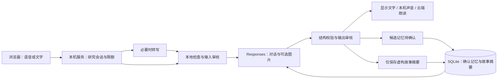

# 小小故事屋：首版探索记录

> 本文记录最初的网页技术实验。用户随后明确 macOS App 与智能伙伴方向；当前交付、原生 Agent 实测和运行方式以 [MACOS_COMPANION.md](MACOS_COMPANION.md) 与 [README.md](README.md) 为准。

验证日期：2026-11-10（新加坡时间）。依据：[PRODUCT_PLAN.md](PRODUCT_PLAN.md)。

## 这次得到的结论

首版可以用 **React + 本地 Node 服务 + SQLite + OpenAI 官方 SDK**，在一套很小的应用里验证中文交流、共同编故事、看图表达和跨会话记忆。暂时不需要向量数据库、额外付费订阅或完整教学框架。

已经交付可运行原型，而不是只有方案。主要体验是小狐狸“栗栗”认真接话，每次留出一个可继续表达的地方。家长确认后的兴趣与词汇记忆、虚构故事摘要保存在本机。

**当前完成的是成人研究原型。** 真实儿童语音、自由说话时的轮次判断、连续对话打断和儿童适用条件尚未完成验证。分段链路的等待仍然偏长，不能据此宣布“自然语音 P0 已完成”。

## 可以体验到什么

| 需求 | 本版实现 | 验证边界 |
| --- | --- | --- |
| 中文交流 | 简短自然回应、一次一个追问、文字输入与录音转写 | 真实 API 已跑通；未做儿童语料评估 |
| 基础英语 | 主动提问时答英语，或家长开启自然穿插；相关词卡 | umbrella 的汉字、拼音与英文已实测 |
| 互动故事 | 共同决定主角和情节，每轮更新虚构摘要 | 云端开篇与新会话续讲已实测 |
| 长期记忆 | 候选 → 家长确认 → 新会话使用；支持纠错和删除 | 已验证确认前不进入提示、纠错后旧会话失效 |
| 看图表达 | 3 张原创插画，上传实际图片给视觉模型 | 云端已识别雨伞、小兔子、小刺猬及躲雨行为 |
| 语言反馈 | 可选的本次讲述观察、自然词卡，不生成能力分数 | 观察允许为空；本次云端样例没有形成观察，不保证每轮生成 |
| 家长管理 | 记忆增删改、声音/英语/时长设置、导出、清空 | UI 及后端均有检查 |
| 语音输出 | 默认本机声音；可选当前 Realtime 模型朗读已审核文字 | 合成语音闭环成功；未进行真人听感评审 |
| 安全约束 | 研究体验门槛、本地窄规则、输入/输出审核、时长/调用上限 | 不是完备的儿童安全系统 |

“本地演示”是明确标注的脚本，帮助查看流程，不具有真正的语义理解或记忆召回。只有“云端体验”调用模型。

## 对标与复用判断

本次做了官方页面、仓库元数据及少量相关源码核实，未安装第三方整套产品，也未让儿童参与试用。以下产品能力是厂商公开描述，不等于独立验证。

| 对象 | 这次核实到的内容 | 对小小故事屋的取舍 |
| --- | --- | --- |
| [Dodi](https://github.com/dodi-education/dodi-app) | Next.js/React/PostgreSQL；家长可管理记忆；AGPL-3.0。记忆源码包含创建、强化、撤销与来源关联 | 参考可编辑记忆和家长入口。首版独立实现较窄的兴趣/词汇记忆；整套接入还涉及部署、账号和许可核对 |
| [HiKid](https://github.com/xiaochong/hi-kid) | macOS Electron 本地链路：SoX、Qwen3-ASR、Ollama、Kitten TTS；LICENSE 为 MIT，但 README 同时写有禁止商业用途的声明 | 保留为后续本地语音实验候选。许可表述存在冲突，本次不复制代码或素材，也未验证其中文 TTS |
| [Pipecat](https://github.com/pipecat-ai/pipecat) | BSD-2-Clause；Python 3.11+ 的可组合语音/多模态框架，提供多种客户端 SDK | 连续语音、VAD、打断阶段再评估；此版直接使用 SDK，降低首轮运行依赖 |
| [Buddy.ai](https://buddy.ai/en/) | 语音交互、游戏和课程组织 | 参考单轮反馈与视觉引导；本版保持自由表达入口，不引入课程体系 |
| [CurioKids](https://curiokidslearn.com/zh) | 中文界面、汉字/拼音/含义、家长设置和多种教学模式 | 参考随话题出现的小词卡；其中文老师面向的家庭语言环境与本产品定位有差异 |
| [Callee Me](https://callee.me/) | 语音通话式教学、学科进度和家长视图 | 参考语音状态与家长信息分层；暂不实现学科进度评定 |
| [Bondu](https://bondu.com/) | 无屏语音玩具、故事选择、记忆和家长控制 | 参考故事连续性；首版不增加硬件成本 |
| [Hey Jini](https://www.heyjini.ai/) | 本次页面读取超时 | 不把前期印象当成已核实的当前功能 |

固定的源码调查点：

- Dodi：`23b89f2d95c2f884a1c0a872c52ff16ac1b09d7b`，最后推送日期 2026-11-10。[AI 包配置](https://github.com/dodi-education/dodi-app/blob/23b89f2d95c2f884a1c0a872c52ff16ac1b09d7b/core/ai/package.json)、[记忆更新实现](https://github.com/dodi-education/dodi-app/blob/23b89f2d95c2f884a1c0a872c52ff16ac1b09d7b/core/ai/src/memory-prompt.ts)。它的默认记忆类别包含能力、困难、情绪等内容，需要按本产品的数据最小化要求重新取舍；OpenAI 包与兼容层存在，不代表当前语音接口可直接复用。
- HiKid：`e3c78992743cd4d2934fa6bad59c12ca5ac7a325`，最后推送日期 2026-04-24。[LICENSE](https://github.com/xiaochong/hi-kid/blob/e3c78992743cd4d2934fa6bad59c12ca5ac7a325/LICENSE)、[README](https://github.com/xiaochong/hi-kid/blob/e3c78992743cd4d2934fa6bad59c12ca5ac7a325/README.md)。
- Pipecat：`bcf7270580fadf61b4c15c78b9b84e5fa474b9fa`。[运行依赖](https://github.com/pipecat-ai/pipecat/blob/bcf7270580fadf61b4c15c78b9b84e5fa474b9fa/pyproject.toml)。

这些记录是选型证据，不是对许可证适用范围或厂商隐私承诺的法律结论。所有第三方完整运行效果都仍未实测。

## 首版技术方案

采用 [Responses 的结构化输出](https://developers.openai.com/api/docs/guides/structured-outputs)，一轮同时得到自然回复、建议、记忆候选、故事摘要、可选词卡与观察。避免再为每个辅助功能额外调用模型。默认文本模型 `gpt-6-luna`，关闭推理以控制此次研究成本，未做模型间的儿童安全或效果排名。

临时会话只在服务端内存中保留有界上下文，原文不写数据库。记忆确认与纠错会使旧会话失效。故事以摘要接续，能保留主要情节，但无法保证逐字记住所有细节。

语音分成两条选择：

| 方案 | 本版状态 | 特点 |
| --- | --- | --- |
| 录音 → `gpt-transcribe` → 文本对话 → 本机声音 | 默认链路 | 容易核对文字与内容；省去云端语音输出费用，体验受设备声音与多次往返影响 |
| 同一条链路，改为 `gpt-realtime-2.1-mini` 朗读 | 可选并已实测 | 统一云端声音；额外等待与费用，需缓冲并核对朗读转写后才播放 |
| 浏览器 WebRTC 实时音频交流 | 下一轮技术实验 | 更接近自然交流、支持打断；需另行设计轮次、服务端约束、记忆工具与音频安全路径 |

当前官方语音文档推荐实时会话作为低延迟自然交流的起点；因此分段链路用于验证产品行为，不作为最终自然语音架构的定案。[Realtime 指南](https://developers.openai.com/api/docs/guides/realtime)、[WebRTC 接入](https://developers.openai.com/api/docs/guides/voice-webrtc?api=realtime)。

本轮还核实了接口变更：旧 TTS 模型计划于 2027-01-06 停用，旧转写模型计划于 2027-02-26 停用，新原型采用当前接口。[语音输出文档](https://developers.openai.com/api/docs/guides/text-to-speech)、[文件转写文档](https://developers.openai.com/api/docs/guides/speech-to-text)。

## 真实接口实测

使用用户授权的密钥和内置虚构文字/合成语音，未上传真实儿童数据。最终成功的一轮记录在 [live-smoke.json](artifacts/live-smoke.json)。下表是单个样本的完整接口等待，不是均值、P95 或首音频延迟。

| 样例 | 实测等待 |
| --- | ---: |
| 中文聊天与兴趣候选 | 4.27 秒 |
| 家长确认后，新会话召回兴趣 | 4.27 秒 |
| 互动故事开篇与摘要 | 4.06 秒 |
| 新会话故事续讲 | 4.06 秒 |
| 实际图片输入的看图表达 | 20.93 秒 |
| 英语词卡 | 3.18 秒 |
| Realtime 朗读完整合成句子 | 3.57 秒，生成 4.3 秒声音 |
| 将该合成声音转写回中文 | 5.87 秒 |

记忆样例中先说喜欢长脖子恐龙，经家长确认后，新会话正确引用这个兴趣。续讲样例保留了“森林里的发光门”，并接受新提出的“星星花园”。英语样例输出“雨伞 / yǔ sǎn / umbrella”。

合成转写文字与测试句一致：**小恐龙在花园里找到一颗会发光的种子。** 这只证明接口链路接通，不能代替真实儿童口音、不完整表达、背景噪音和中英混说测试。[合成声音样例](artifacts/synthetic-voice.wav)。

语音样例调用了 Realtime 适配器；转写走应用实际 `/api/transcribe` 路由。付费朗读路由仅接受服务端生成的 turn ID，权限与输入限制另有自动检查。长段朗读、真实麦克风权限、Safari/iOS 自动播放仍需真人设备验证。

## 成本与性能观察

当前默认文本模型的官方标准短上下文价格为输入 **$0.10 / 百万 tokens**、输出 **$0.50 / 百万 tokens**。最终六个文本回合记录了 5,224 输入、795 输出 tokens，按未缓存价格估算为 **$0.00092**。这只覆盖这轮文本生成，未包含先前调试、语音费用、税费及账户实际结算，不代表赠送额度余额。[官方价格](https://developers.openai.com/api/docs/pricing)。

当前 `gpt-transcribe` 标价为 $0.0045 / 分钟；Realtime Mini 的音频输出按 tokens 计费，当前为 $20 / 百万音频输出 tokens。样例没有完整记录语音计费 tokens，因此不把音频秒数换算成精确账单。本机声音不产生 OpenAI 语音输出费用；浏览器/系统自身的联网行为取决于具体实现。[官方音频价格](https://developers.openai.com/api/docs/pricing)。

默认每日 60 次付费操作限额是本机防误用控制，不是账户余额或金额硬限额。转写统计中的 45 秒是每次录音的保守记账预留，并非实测音频时长；直接适配器语音样例没有进入应用 usage 统计。后续需要采集真实 provider usage，再做每段对话的费用测算。

最需要改进的是等待：普通回合约 3～4 秒，上传图片的样例约 21 秒；合成转写本身约 6 秒，再串行对话和朗读，尚不适合称为自然聊天。下一轮优先比较图片传输压缩、WebRTC 首音频、网络路径和真实设备效果，扩大样本后再决定是否保留分段链路。

## 儿童数据与使用边界

OpenAI 当前要求：处理 13 岁以下或适用数字同意年龄以下儿童个人数据前，应先实施 API 零数据保留。此次没有取得或核实该项目的 ZDR 状态，因此产品固定为成人虚构内容研究预览。[Under-18 指南](https://developers.openai.com/api/docs/guides/safety-checks/under-18-api-guidance)。

`store:false` 已设置，但它不能证明滥用监控等留存已关闭；ZDR 是独立的数据控制，还需要核对具体端点与功能的适用性。[API 数据控制说明](https://developers.openai.com/api/docs/guides/your-data#zero-data-retention)。

本版只做了必要的基础约束：

- 文本的窄隐私规则在联网前拦截明显身份/联系信息；不声称可识别全部个人数据。语音必须先转写才能进行这些文字检查，所以成人测试约束必须覆盖原始录音。
- 云端输入与结构化输出经过审核；审核失败或超时就停止该轮，不回退成伪装的 AI 回复。审核模型不是适龄内容完整判定器。
- 记忆候选需要家长确认；不接受明显身份信息、能力标签或指令式记忆。只保存最多 60 条记忆、20 篇故事摘要、10 条观察。
- 云端声音只读服务端已通过检查的文字；缓冲收到的 PCM，核对朗读转写与原文字一致后才返回。失配或连接失败改用本机声音；它不是低延迟流式音频方案。
- 结束会话、删除或修改记忆后，迟到的请求不能恢复已删数据；自动检查覆盖了这个竞态。
- 成人算术验证不是认证；数据库也没有额外应用层加密。服务仅监听本机，并限制跨站与 Host 访问，不适合多人、公开部署或联网给孩子使用。

官方还建议面向未成年人的体验使用最新旗舰模型。本版的低成本模型选择服务于成人实验；真实儿童阶段必须重新做模型选型、安全评估和适用条件核对，不能直接沿用当前默认值。[Under-18 指南](https://developers.openai.com/api/docs/guides/safety-checks/under-18-api-guidance)。

## 本地验证与交付

- `npm test`：24 项通过，包括成人研究入口、跨站/Host 拒绝、隐私拦截、审核失败处理、记忆确认与纠错、SQLite 重启续讲、数据删除竞态、限额和会话时长。
- `npm run build`：类型检查与生产构建通过。有 Lucide 的模块指令提示，不影响本应用已测的客户端行为。
- `npm run test:ui`：独立临时库，桌面与 390px 窄屏检查通过；涵盖成人入口、文字发送、家长记忆确认、故事与图片切换、录音按钮尺寸和无未捕获错误。
- `npm run smoke:live`：中文、记忆、续讲、图片、英语、当前语音合成与转写、隐私拦截、清空数据通过。测试数据库在结束后删除，证据仅含虚构样例。
- Codex 内嵌浏览器控制两次超时；独立本机 Chrome 完成上述检查。桌面侧边预览是否成功展示仍不以此代替验证。
- 密钥仅注入进程环境，未写入源码、`.env`、日志、前端或报告。没有部署外网、购买订阅、创建新密钥或推送远程仓库。

截图：[桌面](artifacts/ui-desktop.png)、[看图表达](artifacts/ui-picture.png)、[家长记忆](artifacts/ui-parent.png)、[390px 窄屏](artifacts/ui-mobile.png)。运行说明见 [README.md](README.md)。

## 下一步怎么收敛

1. **先改善语音等待**：用同一组成人虚构脚本比较分段链路与 WebRTC，记录结束说话到首音频的 P50/P95、误打断、漏转写及实际费用；同时减小视觉输入传输开销。
2. **核实儿童使用条件**：确认项目 ZDR 与所用端点、家长知情流程及适用要求，再决定能否开展真实家庭测试。当前原型保持成人研究用途。
3. **建立小型表达评估集**：覆盖只说半句、中英混说、反复改故事、拒绝回答、敏感话题及记忆纠错；用可观察行为判断是否善于倾听，不把模型输出当发展测评。
4. **再考虑更重的组件**：如果自然打断和多端语音成为瓶颈，再验证 Pipecat；如果本地成本/隐私需求更强，再单独验证 HiKid 相关语音组件。保持数据结构与 provider 适配层清楚，便于替换。

原生安装包、账号体系、真正的平板麦克风/扬声器测试、连续免按键对话、自动 VAD、生产部署、完整安全审计及第三方项目实机对比均未包含在本次完成范围中。
