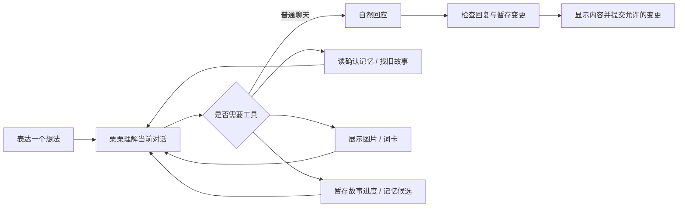

# macOS 智能伙伴：方向修正与交付

> 此文记录前一阶段。当前统一入口、彩虹独角兽品牌与连续语音电话见 [0.4 体验修正](V04_EXPERIENCE_FIXES.md)。

2026-11-10。用户明确：与其他“小小”App 一样交付 macOS 应用，并参考 Codex 的智能伙伴工作方式。

## 已落实的改变

| 方面 | 当前实现 |
| --- | --- |
| 交付 | SwiftUI 原生 `.app`，独立窗口、Dock 图标、菜单与快捷键 |
| 运行依赖 | 直接使用 macOS SDK；用户不需要 Node、浏览器或常驻 HTTP 服务 |
| 伙伴交互 | 单一持续对话，模型按需选择故事、记忆、图片与词卡工具 |
| 上下文 | 本轮原文在内存中延续；确认记忆、虚构故事摘要跨启动保留 |
| 语音 | AVAudioEngine 内存录音，原生云端转写请求，本机朗读 |
| 密钥与数据 | 系统钥匙串与应用支持目录；测试可只注入进程临时密钥 |

应用是独立桌面程序，界面和模型网络请求均在原生进程中。没有将初次网页套进 WebView，也没有在 `.app` 内启动 Node 服务。

本次查看了小小思考屋与小小历史旅行团的桌面配置，确认它们以 `.app` 交付。故事屋保持相同的桌面使用方式；因为主要需求是动态对话、麦克风和密钥管理，本轮使用系统原生框架实现。其他项目没有被修改。

## “像 Codex”如何落地

取其持续上下文和工具协作机制，围绕儿童表达设计领域能力：

模型通过正式 function call 提出动作，本机执行对应代码，再将真实结果回传模型。图片工具返回实际图像，故事工具读取数据库并留下可续讲的摘要。普通聊天可以不使用工具。

当前使用 Responses 的本机函数调用回路，保留 `store:false`，没有引入云端代码沙箱。[OpenAI function calling 官方流程](https://developers.openai.com/api/docs/guides/function-calling)。

界面中只有一位栗栗、一条对话。图片、词卡和简短动作提示出现在对话里，侧栏保存故事；建议语句只是开场灵感，不会切换固定模式。

## 边界与一致性

- 7 个领域工具，不暴露任意网址、文件操作或终端能力。
- 一轮最多 4 次模型请求、8 个工具调用；每日付费操作共用本地上限。
- 记忆候选依据必须来自当前用户原话；确认前不出现在记忆读取结果中。
- 写入变更先暂存，最终检查失败、取消或数据修订时不提交。
- 编辑或删除记忆后旧上下文失效；清空数据后未完成的请求不能恢复它。
- 停止朗读、开始新一段语音保留对话上下文；开启新对话才重置上下文。
- 新故事使用新 ID，续讲使用真实查到的 ID，避免误覆盖。

这些仍是研究约束，不是完整的儿童安全认证。当前保留成人虚构内容入口，未核实项目的 ZDR 状态，没有真实儿童使用开关。[OpenAI 未成年人指南](https://developers.openai.com/api/docs/guides/safety-checks/under-18-api-guidance)。

## 实测证据

原生检查 **18/18 通过**，覆盖普通聊天、确认记忆、多轮工具回路、图片返回形状、未知工具、失败不提交、取消与删除竞态、打断保留上下文、记忆依据、关闭记忆、故事 ID、限额与导出。

真实 OpenAI 检查通过，使用原生 Swift URLSession 和本机 Agent，内容全部虚构：

| 用户意图 | 模型实际动作 | 单样本等待 |
| --- | --- | ---: |
| 记得我喜欢什么动物 | 读取确认记忆，回答“小企鹅” | 11.32 秒 |
| 继续星星花园，将种子放进花盆 | 找故事 → 读故事 → 保存进度 | 11.69 秒 |
| 看下雨的画，描述小动物 | 展示 rain，正确描述兔子、刺猬与雨伞 | 9.47 秒 |
| 展示雨伞词卡 | 展示“雨伞 / yǔ sǎn / umbrella” | 6.83 秒 |

四轮共 10 次模型请求，10,973 输入、489 输出 tokens。[原生真实调用记录](artifacts/native-live.json)。等待包含工具往返和检查，不是首音频延迟或稳定性能统计。工具能力已接通，等待仍需优化。

实际 `.app` 启动验证通过，创建 1160 × 820 原生窗口，bundle ID 为 `com.jexceed.tinytales`。图标和资源已打包，ad-hoc 签名验证通过。[启动记录](artifacts/native-launch.json)、[本应用窗口内容截图](artifacts/native-window.png)。

原生麦克风权限、真实录音质量、扬声器回声与系统声音的真人听感尚未完成手动验收；连续免按键 VAD、实时首音频、分发公证和跨设备同步仍未实现。没有把首次网页的语音实测当作原生麦克风验证。

## 下一轮重点

先验证本机麦克风与声音、自然打断，再比较实时音频与当前分段转写的延迟。故事与记忆继续作为本机能力，语音传输方式可独立调整。

围绕连续场景做完整体验：昨天的故事今天接着讲、对话中临时想看图、修改旧偏好后正确回应、讲到一半切回日常分享。判断标准是能否接住上下文和意图。
